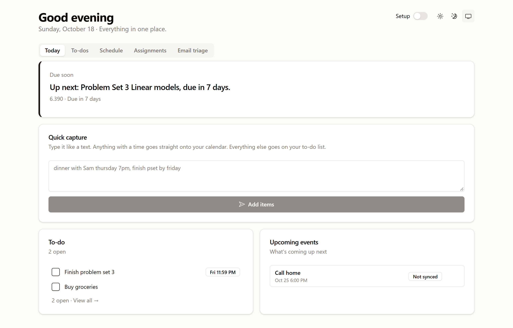

# Daily OS


A single-user student dashboard for notes, to-dos, assignments, email, and calendars.
Run your own copy locally, then connect only the accounts you want. You do not need
a cloud account or integration credentials to try the basic app.



## What it does

- **Today:** due-soon assignments, to-dos, quick capture, and a daily quote.
- **Notes:** titled notes saved to your backend. Click **Save note**; drafts survive
  tab switches, and saved notes survive restarts.
- **Quick capture:** natural-language to-dos and events. New events can go to Google
  or iCloud; a matching writable course calendar is chosen when possible.
- **Schedule:** today, tomorrow, and the day after across connected calendars.
  **Choose calendars** hides calendars you do not attend and excludes them from
  free-time calculations without changing the original calendars.
- **Assignments:** Canvas sync, syllabus deadline capture, and visible Gradescope
  links. Gradescope submissions happen on Gradescope, not inside this app.
- **Email triage:** sync up to 100 messages per account. Click a message to open it
  in Gmail or Outlook. Sorting marks it read and moves it to a real label/folder.
  Trash is reversible with **Undo**, not permanent deletion.
- **Daily quotes:** attributed, inspiring and thought-provoking excerpts, including
  Ursula K. Le Guin. A quote stays the same all day and changes at local midnight.

This is a personal, self-hosted tool, **not a multi-user hosted service**. Each
person should run their own copy with their own database and credentials.

## Quick start: no integrations needed

Install **[Node.js 24 LTS](https://nodejs.org/)** and Git first. Check
`node --version`; it should start with `v24` (or a supported newer even-numbered release).
Windows PowerShell, macOS, and Linux use the same commands:

```sh
git clone https://github.com/megkhampton-afk/daily-os.git
cd daily-os
npm ci
npm run dev
```

The first start downloads and starts Convex's local backend, writes `.env.local`,
and opens **http://localhost:5173**. Internet access is needed for the initial
package/backend downloads. No Convex login is required for this local mode.

1. Create a **long, unique passcode** when prompted.
2. Try adding a to-do and a titled note. Notes use a **Save note** button.
3. Turn **Setup** on in the header when you want to connect accounts.
4. Keep the terminal running. Stop it with **Ctrl+C** when finished.

Setup starts **off** on each app launch. No assignments or mail appear until you
connect a provider and run its sync.

### Where your data lives

In default local mode, application data is stored under this project's `.convex`
directory. `.env.local` records the backend connection. Both are gitignored:
**do not delete or share them**. Keep a backup before moving computers or changing
backend modes.

Connected providers necessarily receive requests from the backend. If you choose
a hosted Convex backend later, your data and saved credentials live there instead
of only on your computer. This app is not offline-only or end-to-end encrypted.

## Connect your accounts

Open **Setup** using the switch in the header. Paste credentials into the named
cards in the app, **not into source code**. All integrations are optional.

| Connection | What you need | Where it goes |
| --- | --- | --- |
| Canvas | School's Canvas base URL and a personal access token | **Setup → Canvas → Canvas address / Access token → Save** |
| Google Calendar + Gmail | Your own Google OAuth **Web application** client ID and secret | **Setup → Google → Client ID / Client secret → Save**, then **Email triage → Connect** |
| Apple Calendar | Apple ID email and an app-specific password | **Setup → Apple Calendar → Apple ID email / App-specific password → Save → Test connection** |
| Outlook / Microsoft 365 | Your own Entra app's client ID and client-secret **Value** | **Setup → School email → Application (client) ID / Client secret value → Save**, then **Email triage → Connect** |
| Gradescope | A course URL copied from your browser | **Assignments → Set up or edit Gradescope course links** |

**[Full connection guide](docs/CONNECTING.md)** includes exact steps, required
permissions, redirect URIs, verification steps, and common error messages.

After connecting mail, choose your labels/folders under **Setup → Sorting folders**,
then click **Email triage → Sync inbox**. You can create a real folder there too.
Use a disposable test message before sorting important mail.

Google's OAuth **Testing** mode commonly expires these refresh tokens after seven
days; use **Reconnect** when needed. Institutional Microsoft/Canvas policies may
require administrator approval. The app cannot bypass those policies.

## Run the checks

```sh
npm run check
```

This runs type checking, lint, automated tests, a production build, and a dependency
audit. Tests use fake accounts/messages and do not touch real email or calendars.
The test dependencies are installed and version-locked by `npm ci`.

Individual commands:

```sh
npm test
npm run lint
npm run build
npm audit --audit-level=moderate
```

GitHub Actions runs the same checks on Linux and Windows.
See **[the test-user checklist](docs/TESTING.md)** before connecting a real account.

## Use it from a phone or host your own copy

**Do not use `vite --host` alone for a phone.** A local backend URL such as
`http://127.0.0.1:3210` points to the phone itself, not your computer. A publicly
hosted frontend also cannot use that local backend.

For reliable phone access, use an HTTPS frontend and your **own** hosted Convex
backend. See **[Hosting and phone setup](docs/HOSTING.md)**. This is a separate,
optional deployment step; local data is not automatically migrated.

Do not expose the local development backend or its admin endpoint to the internet.

## Troubleshooting

| Symptom | Check |
| --- | --- |
| Wrong Node version / `EBADENGINE` | Install Node 24 LTS, open a new terminal, run `npm ci` again. |
| Port 5173 is in use | Stop the other development server. This app uses a fixed port so redirects remain correct. |
| Blank app / missing `VITE_CONVEX_URL` | Start with `npm run dev`, not `vite` alone. Let initial backend provisioning finish. |
| Forgot passcode | With your backend running, run `npx convex run settings:resetPasscode`; reload and set a new passcode. This preserves application data. |
| Google `redirect_uri_mismatch` | Copy **exactly** the redirect URI shown in your own Setup card into your OAuth Web client's authorized redirects. |
| Calendar can write but cannot read/pick calendars | Click **Reconnect** and allow calendar-list access as well as event access. |
| Google “access blocked” | Check your own address is an OAuth test user and both APIs/scopes are configured. |
| Microsoft “Need admin approval” | Ask your IT team; use only accounts your organization permits. |
| Gradescope shortcut is missing | Save the course URL from Assignments; use the exact course name/code shown there. |

More provider-specific fixes are in [the connection guide](docs/CONNECTING.md).

## Privacy and limits

- One shared passcode protects one user's data. The browser remembers it in local
  storage. Anyone with the passcode can read and change the data. This is not
  hardened authentication for a public, multi-user service.
- Tokens/secrets are saved in your backend settings and are not returned to the
  frontend. That does not mean the database is end-to-end encrypted.
- The first person to open an unconfigured copy can create its passcode. Create it
  before sharing a hosted URL. Never share your personal deployment with testers.
- Do not commit `.env.local`, `.convex`, provider tokens, passwords, or real-data
  screenshots. Revoking access is done in the provider's account settings.
- Email sorting/trashing changes your real mailbox. Undo is available in the toast
  shortly after the operation. Deleted items remain subject to provider retention.
- The current queue is bounded to 100 messages per account, not a full mailbox
  archive. Schedule covers three days. Notes lists the 100 most recently edited
  notes. Canvas sync currently reads up to 50 courses and 100 assignments per course.
- Local scheduled sync runs only while the backend is running. Canvas's daily cron
  uses 13:00 UTC; manual **Sync Canvas** is always available.
- Third-party OAuth/permissions and institutional policies require a real-account
  check; passing unit tests is not a promise that every institution allows access.

## Project layout

```text
src/                   React dashboard and UI
convex/                Backend schema, functions, integrations, fake-data tests
scripts/dev.mjs        Local-first development launcher
scripts/check-*.mjs    Mail and calendar regression checks
docs/                  Connection, hosting, and test-user instructions
.github/workflows/     Linux and Windows validation
```

Built with React, Convex, Vite, Tailwind CSS, shadcn/ui, and chrono-node.
Quote authors and original works are attributed in `src/lib/quotes.ts`; those
excerpts remain attributable to their respective authors.

## License

MIT for the application code. See [LICENSE](LICENSE).

Built with [Factory Droid](https://factory.ai).
